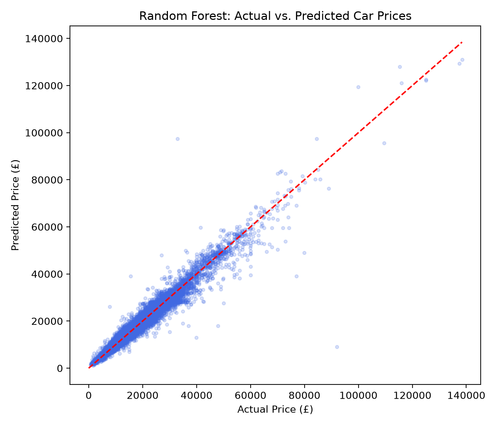

# UK Used Car Price Prediction

A machine learning project that predicts the resale price of a used car based on its brand, model, age, mileage, transmission, fuel type, tax, mpg, and engine size — built using real UK used-car listings across 9 manufacturers.

## Project Overview

This project takes raw, per-brand CSV exports, cleans and merges them into a single dataset, trains and compares two regression models, and saves the better-performing model as a reusable pipeline that can price a car from nine raw inputs.

## Dataset

Source: UK Used Car Dataset, split across one CSV per manufacturer (`data/raw/`):

- Audi, BMW, Ford, Hyundai, Mercedes, Skoda, Toyota, Vauxhall, Volkswagen

Each listing includes: `model`, `year`, `price`, `transmission`, `mileage`, `fuelType`, `tax`, `mpg`, `engineSize`.

**Note:** Hyundai's source file names its tax column `tax(£)` instead of `tax` — this is corrected during cleaning so all 9 files merge into consistent columns.

## Data Cleaning

Steps performed in `load_data.py`:
- Merged all 9 brand CSVs into one dataset, adding a `brand` column (not present in the source files)
- Fixed the `tax(£)` → `tax` column name mismatch
- Removed 1,484 duplicate and invalid rows (including a car listed with `year = 2060` and two listed as `year = 1970`, both clear data-entry errors)
- Engineered an `age` feature (`2020 - year`), since vehicle age correlates with price more directly than the raw year
- Saved the cleaned dataset to `data/processed/cars_cleaned.csv` (97,703 rows, 11 columns)

## Modeling

Built in `train_model.py`, using scikit-learn's `ColumnTransformer` + `Pipeline` so preprocessing and the model are saved together as one object (no manual encoding/column-matching needed at prediction time):
- **Numeric features** (`age`, `mileage`, `tax`, `mpg`, `engineSize`) — scaled with `StandardScaler`
- **Categorical features** (`brand`, `model`, `transmission`, `fuelType`) — one-hot encoded with `OneHotEncoder(handle_unknown="ignore")`

Two models were trained and compared on an 80/20 train/test split:

| Model | R² | MAE | RMSE |
|---|---|---|---|
| Linear Regression | 0.8642 | £2,257 | £3,617 |
| **Random Forest (final)** | **0.9569** | **£1,175** | **£2,038** |

Random Forest was chosen as the final model. Its trees were capped at `max_depth=20` with `min_samples_leaf=2` — this reduced the saved model file from 656MB (unlimited depth) to **47.8MB**, while only slightly affecting accuracy (R² dropped from 0.9603 to 0.9569), suggesting the deeper trees were mostly overfitting rather than adding real predictive value.

## Results



Predictions track actual prices closely across most of the price range, with the model's accuracy naturally decreasing for rare, high-value vehicles (£80,000+) where fewer comparable listings exist to learn from.

## Project Structure

```
car-price-prediction/
├── data/
│   ├── raw/                     # original per-brand CSVs
│   └── processed/
│       └── cars_cleaned.csv     # merged, cleaned, feature-engineered dataset
├── models/
│   └── car_price_model.pkl      # trained pipeline (preprocessing + model)
├── images/
│   └── actual_vs_predicted.png
├── load_data.py                 # load, merge, clean, save dataset
├── train_model.py               # train, compare, and save the final model
├── evaluate.py                  # load saved model, generate evaluation plot
├── predict.py                   # predict the price of a new car
├── requirements.txt
└── .gitignore
```

## Installation

```bash
git clone https://github.com/YOUR-USERNAME/car-price-prediction.git
cd car-price-prediction
python -m venv venv
venv\Scripts\activate
python -m pip install -r requirements.txt
```

## Usage

**1. Clean and merge the raw data:**
```bash
python load_data.py
```

**2. Train and save the model:**
```bash
python train_model.py
```

**3. Generate the evaluation plot:**
```bash
python evaluate.py
```

**4. Predict a new car's price:**
```bash
python predict.py
```
Edit the `new_car` dictionary inside `predict.py` to describe a different car.